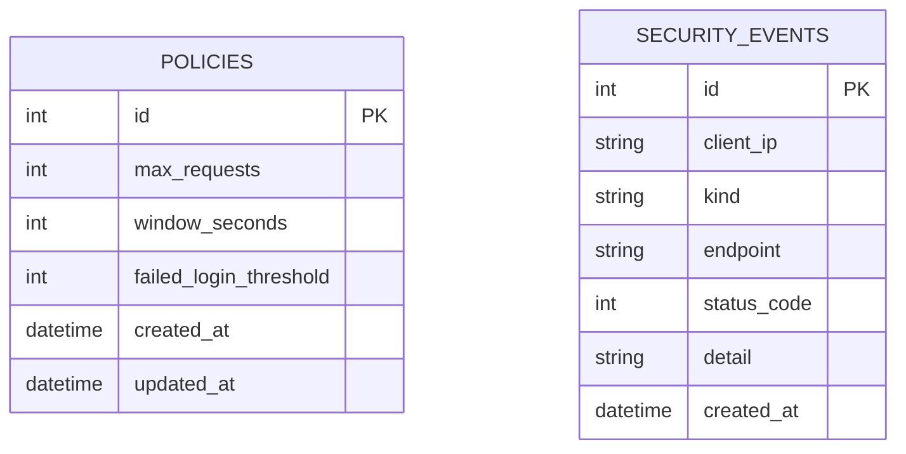

# ERD



Policy configures request inspection; events are immutable historical records. There is no direct FK because a single global policy applies to the local MVP.

## DBML

```dbml
Table policies {
  id integer [pk]
  max_requests integer [not null]
  window_seconds integer [not null]
  failed_login_threshold integer [not null]
  created_at datetime [not null]
  updated_at datetime [not null]
}
Table security_events {
  id integer [pk, increment]
  client_ip varchar(45) [not null]
  kind varchar(32) [not null]
  endpoint varchar(128) [not null]
  status_code integer [not null]
  detail varchar(120) [not null]
  created_at datetime [not null]
  indexes { (client_ip, created_at) }
}
```
